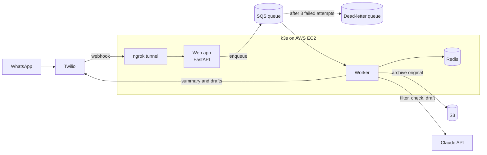

# Message Filter

An AI assistant for high-conflict messages. You forward a hostile WhatsApp message to it; it replies with only the practical facts, double-checks its own summary, and drafts calm replies you can choose to send. It runs on Kubernetes on AWS and is in personal use.

Built in Python with FastAPI, the Claude API, AWS (SQS, S3, IAM, EC2), Redis, Docker, Kubernetes (k3s) and GitHub Actions.

## How it works



What happens to one message:

1. **You forward the message** to the service's WhatsApp number, which Twilio receives.
2. **The web app accepts it in under a second.** It verifies Twilio's signature and that the message came from you, puts a job on an SQS queue, and replies to Twilio straight away. The AI work takes 5 to 12 seconds, which is too close to Twilio's 15-second webhook timeout to do inside the request.
3. **The worker picks up the job.** It records the message ID in Redis so a duplicate delivery is skipped, then archives the original, unchanged, to S3.
4. **Three agents do the work.** A filter agent extracts the facts, resolving dates with a calendar tool. Then a checker agent reviews that summary against the original while a reply agent drafts responses, both at the same time.
5. **You get the result on WhatsApp:** the facts, any warnings from the checker at the top, and each draft reply as a separate message, ready to copy.

If any step fails, the job stays on the queue and SQS delivers it again. After three failed attempts, it moves to a dead-letter queue for inspection, so a message is never silently lost.

## The agents

Each step is a separate call to Claude, with its own prompt and a typed result. Every result is validated against a Pydantic model before the code uses it.

| Agent | Model | Job | Returns |
| --- | --- | --- | --- |
| Filter | Claude Sonnet | Extract the practical facts; flag threats, legal mentions and vague details | Facts, whether a reply is needed, the questions asked, notes |
| Checker | Claude Sonnet | Compare the summary with the original and report anything missing, wrong, hostile or unflagged | A list of problems, each with a kind and a description |
| Reply | Claude Haiku | Draft one to three calm, brief replies that never invent facts | Labelled draft replies |

**The tool loop is written by hand.** Models get relative dates wrong, so the filter doesn't work out "next Friday" itself: it calls a deterministic `next_weekday` tool. The loop runs the requested tool and returns the result to the model. A tool error is reported back to the model rather than crashing the request, and the loop stops after five rounds so a confused model can't loop forever.

**The message is treated as data, never as instructions.** It is wrapped in tags, and the prompt tells the model to treat anything inside them as content to summarize. So a message saying "ignore your instructions" is reported, not obeyed.

**Failures degrade safely.** If the filter fails, you get an apology, never the unfiltered original. If the checker or the reply agent fails, you still get the summary, with a note saying what's missing.

## Evaluation

Prompt changes are tested against an answer key, not judged by eye. The cases are invented messages, kept out of the prompts so the system can't simply memorize them.

Each case lists the facts a correct summary must contain, whether a reply is needed, the safety flags expected, and hostile phrases that must not leak through. Most checks are plain code. Whether a summary conveys a fact is judged by a separate Claude call, an LLM-as-judge, which writes its reasoning before its verdict.

The checker is evaluated too: how often it catches a summary that's wrong (its catch rate), and how often it raises a problem with a correct one (its false alarms).

Results that changed the design:

| Finding | Decision |
| --- | --- |
| Haiku as the filter repeatedly missed a question buried in a long message, and prompt changes didn't fix it | Moved the filter to Sonnet, which passed all 7 cases. Sonnet costs twice as much per token, which is negligible at personal volume |
| The checker caught Haiku's missed question, with no false alarms across 12 correct summaries | Kept the checker as an independent safety net |
| A checker on Haiku missed a summary that reversed who was doing what; on Sonnet it caught it | Moved the checker to Sonnet |
| Some failures were the answer key's fault, or the judge being too literal | Fixed the cases and the judge prompt, not the system: a failing evaluation has three possible causes, and only one is the code |

Run it with:

```
uv run --env-file .env python -m message_filter.evaluate sonnet
```

## Design decisions

### Reliability

- **A queue sits between the webhook and the AI work.** Twilio expects an answer within 15 seconds, and the AI work takes up to 12. With a queue, the web app answers at once and a separate worker does the slow part. It also makes the system durable: a message that arrives while the worker is down waits on the queue and is processed when the worker returns.
- **Duplicates are expected and handled.** SQS delivers every message at least once, which means occasionally twice. Before processing, the worker claims the message ID in Redis with an atomic set-if-absent that expires after 45 seconds. That's longer than the slowest job and shorter than the queue's 60-second retry window, so a crashed worker's claim clears itself before the retry. A finished message is marked done for 7 days, and it is marked done before its job is deleted from the queue, so a failure between the two steps can't cause reprocessing.
- **Fail open where a mistake is cheap, fail closed where it isn't.** If Redis is unreachable, the worker processes the message anyway: a duplicate summary is a nuisance, a lost message is not. The security checks do the opposite: if their configuration is missing, they reject everything.
- **Nothing is lost silently.** A job that fails three times moves to a dead-letter queue.
- **The worker shuts down cleanly.** On SIGTERM it finishes the message it's working on and takes no new ones. The pod's grace period is 60 seconds, enough for a 20-second queue poll plus the slowest job.
- **Dates use New York time, not the server's clock.** The server runs on UTC, which would make "today" wrong every evening after 8 p.m.

### Security and privacy

- **Only Twilio, and only you.** Every webhook request must carry a valid Twilio signature and come from the one allowed number.
- **Message text never appears in logs.** The code logs message IDs only. Third-party libraries log at warning level only, since one of them logs request details at info level.
- **The original is kept exactly as received.** It's archived to a versioned S3 bucket, and the app's permissions don't include deleting anything.
- **Least privilege throughout.** The app may write and read objects in one bucket, and send, receive and delete on one queue. Nothing else.
- **No stored AWS keys on the server.** The server gets temporary, automatically rotated credentials from an IAM role.
- **No open inbound ports apart from SSH from one address.** Twilio reaches the app through an outbound ngrok tunnel, so the server accepts no incoming web traffic at all.
- **Secrets never touch Git or the image.** They live in Kubernetes Secrets, created from local files. The Docker build copies only an explicit allow-list of files, so a `.env` can never be baked into an image.
- **Real messages never enter the repository.** Every test and evaluation case uses invented messages.

### Testing

About 60 unit tests run on every push in GitHub Actions. They replace Claude, SQS, S3, Twilio and Redis with fakes, so they need no API keys and cost nothing. A separate set of tests calls the real models (test*_llm.py), and is run by hand when prompts change.

## Running it

You'll need Python 3.12, [uv](https://docs.astral.sh/uv/) and Docker. You'll also need accounts with Twilio (the WhatsApp sandbox is enough), Anthropic, AWS (one SQS queue with a dead-letter queue, and one S3 bucket) and ngrok.

Copy `.env.example` to `.env` and fill in your own values. Then:

```
uv sync
uv run pytest              # unit tests, no keys needed
uv run pytest -m llm       # tests against the real models
docker compose up --build  # web app, worker and Redis
```

Expose the web app with ngrok and set the Twilio sandbox's webhook to `https://<your-ngrok-domain>/whatsapp`.

### Deploying to Kubernetes

The manifests in `k8s/` run Redis, the web app, the worker and the ngrok agent. They expect three Secrets: `app-env` (the settings from `.env`), `ghcr-pull` (a read-only registry token) and `ngrok` (the ngrok authtoken). On AWS, the server's IAM role provides credentials, so no AWS keys are needed.

```
kubectl apply -f k8s/
```

Every push to `master` runs the tests and, if they pass, publishes a new image tagged with the commit ID. To deploy it:

```
kubectl rollout restart deployment/web deployment/worker
```

## Next steps

- **Automatic deploys.** Designed but not built: GitHub Actions would authenticate to AWS with OIDC, so no keys are stored in GitHub, and trigger a fixed Systems Manager command on the server that accepts only a commit ID. It needs no inbound ports. It's blocked on this account because the AWS Free Plan doesn't offer OIDC identity providers.
- **Metrics.** Prometheus and Grafana for time per message, failures, and Claude tokens and cost per message.
- **Conversation memory.** Store recent summaries in Redis so the agents can see earlier messages. The filter could resolve references like "as I said yesterday" or "the usual time", and the reply agent could keep drafts consistent with what was already agreed. It would store the filtered facts, not the original hostile text, and expire them after a set period, to keep the privacy rules intact.
- **A stronger evaluation.** At least 20 cases, and scoring whether the checker names the actual problem rather than any problem.
- **Narrower permissions per component.** The web app doesn't need the Claude key or S3 access. Each component should get only its own secrets and its own IAM role.
- **At larger scale.** Receive webhooks through an ingress with TLS on a real domain instead of a tunnel, use managed Redis, and run several workers. The duplicate handling already makes extra workers safe.