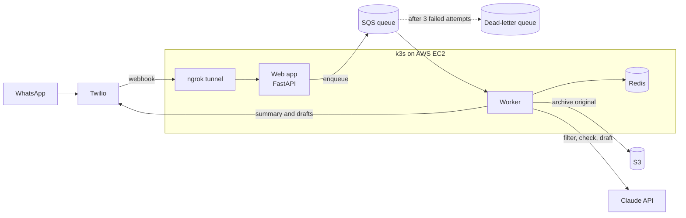

# Message Filter

An AI assistant for high-conflict messages. You forward a hostile WhatsApp message to it; it replies with only the practical facts, double-checks its own summary, and drafts calm replies you can choose to send. It runs on Kubernetes on AWS and is in personal use.

Built in Python with FastAPI, the Claude API, AWS (SQS, S3, IAM, EC2), Redis, Docker, Kubernetes (k3s) and GitHub Actions.

## How it works

What happens to one message:

1. **You forward the message** to the service's WhatsApp number, which Twilio receives.
2. **The web app accepts it in under a second.** It verifies Twilio's signature and that the message came from you, puts a job on an SQS queue, and replies to Twilio straight away. The AI work takes 5 to 12 seconds, which is too close to Twilio's 15-second webhook timeout to do inside the request.
3. **The worker picks up the job.** It records the message ID in Redis so a duplicate delivery is skipped, then archives the original, unchanged, to S3.
4. **Three agents do the work.** A filter agent extracts the facts, resolving dates with a calendar tool. Then a checker agent reviews that summary against the original while a reply agent drafts responses, both at the same time.
5. **You get the result on WhatsApp:** the facts, any warnings from the checker at the top, and each draft reply as a separate message, ready to copy.

If any step fails, the job stays on the queue and SQS delivers it again. After three failed attempts, it moves to a dead-letter queue for inspection, so a message is never silently lost.