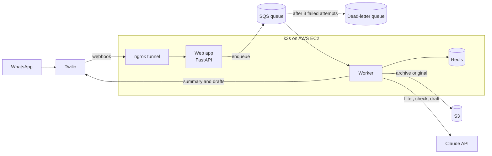

# Message Filter

An AI assistant for high-conflict messages. You forward a hostile WhatsApp message to it; it replies with only the practical facts, double-checks its own summary, and drafts calm replies you can choose to send. It runs on Kubernetes on AWS and is in personal use.

Built in Python with FastAPI, the Claude API, AWS (SQS, S3, IAM, EC2), Redis, Docker, Kubernetes (k3s) and GitHub Actions.

## How it works



What happens to one message:

1. **You forward the message** to the service's WhatsApp number, which Twilio receives.
2. **The web app accepts it in under a second.** It verifies Twilio's signature and that the message came from you, puts a job on an SQS queue, and replies to Twilio straight away. The AI work takes 5 to 12 seconds, which is too close to Twilio's 15-second webhook timeout to do inside the request.
3. **The worker picks up the job.** It records the message ID in Redis so a duplicate delivery is skipped, then archives the original, unchanged, to S3.
4. **Three agents do the work.** A filter agent extracts the facts, resolving dates with a calendar tool. Then a checker agent reviews that summary against the original while a reply agent drafts responses, both at the same time.
5. **You get the result on WhatsApp:** the facts, any warnings from the checker at the top, and each draft reply as a separate message, ready to copy.

If any step fails, the job stays on the queue and SQS delivers it again. After three failed attempts, it moves to a dead-letter queue for inspection, so a message is never silently lost.

## The agents

Each step is a separate call to Claude, with its own prompt and a typed result. Every result is validated against a Pydantic model before the code uses it.

| Agent | Model | Job | Returns |
| --- | --- | --- | --- |
| Filter | Claude Sonnet | Extract the practical facts; flag threats, legal mentions and vague details | Facts, whether a reply is needed, the questions asked, notes |
| Checker | Claude Sonnet | Compare the summary with the original and report anything missing, wrong, hostile or unflagged | A list of problems, each with a kind and a description |
| Reply | Claude Haiku | Draft one to three calm, brief replies that never invent facts | Labelled draft replies |

**The tool loop is written by hand.** Models get relative dates wrong, so the filter doesn't work out "next Friday" itself: it calls a deterministic `next_weekday` tool. The loop runs the requested tool and returns the result to the model. A tool error is reported back to the model rather than crashing the request, and the loop stops after five rounds so a confused model can't loop forever.

**The message is treated as data, never as instructions.** It is wrapped in tags, and the prompt tells the model to treat anything inside them as content to summarize. So a message saying "ignore your instructions" is reported, not obeyed.

**Failures degrade safely.** If the filter fails, you get an apology, never the unfiltered original. If the checker or the reply agent fails, you still get the summary, with a note saying what's missing.

## Evaluation

Prompt changes are tested against an answer key, not judged by eye. The cases are invented messages, kept out of the prompts so the system can't simply memorize them.

Each case lists the facts a correct summary must contain, whether a reply is needed, the safety flags expected, and hostile phrases that must not leak through. Most checks are plain code. Whether a summary conveys a fact is judged by a separate Claude call, an LLM-as-judge, which writes its reasoning before its verdict.

The checker is evaluated too: how often it catches a summary that's wrong (its catch rate), and how often it raises a problem with a correct one (its false alarms).

Results that changed the design:

| Finding | Decision |
| --- | --- |
| Haiku as the filter repeatedly missed a question buried in a long message, and prompt changes didn't fix it | Moved the filter to Sonnet, which passed all 7 cases. Sonnet costs twice as much per token, which is negligible at personal volume |
| The checker caught Haiku's missed question, with no false alarms across 12 correct summaries | Kept the checker as an independent safety net |
| A checker on Haiku missed a summary that reversed who was doing what; on Sonnet it caught it | Moved the checker to Sonnet |
| Some failures were the answer key's fault, or the judge being too literal | Fixed the cases and the judge prompt, not the system: a failing evaluation has three possible causes, and only one is the code |

Run it with:

```
uv run --env-file .env python -m message_filter.evaluate sonnet
```